# CANDRON OneERP — Client Handover & Operations Manual

This is the complete guide to running CANDRON OneERP: what it does, who uses it,
the end-to-end project flow, and step-by-step procedures for every module.

**Companion documents**
- `SOP.md` — a short acceptance-test (UAT) script to validate the deployment.
- `DEPLOYMENT.md` — how to deploy and configure the application.
- `AUDIT.md` — production-readiness status and the remaining fast-follows.

---

## 1. What OneERP is

OneERP manages the **complete lifecycle of an electrical-equipment project** —
from the first inquiry to warranty — on a single, traceable "spine." Every
inquiry becomes a **project**, and every project moves forward through the same
22-stage lifecycle. Every document it produces (configuration, cost sheet,
quotation, drawings, certificates) is versioned and attached to its project.

It is **multi-tenant**: each manufacturer is a separate workspace with its own
users, product families, rate cards, commercial terms and branding.

### Modules

| Group | Module | What it does |
|---|---|---|
| Workspace | **Overview** | Portfolio dashboard — order book, pipeline, margins, items needing attention, recent activity. |
| Workspace | **Projects** | Every project and its workspace (the lifecycle spine + all its artifacts). |
| Sales | **Pipeline** | Opportunities from lead to won. A won opportunity becomes a project. |
| Sales | **Customers** | Customers, contacts, communication history and per-customer commercial terms. |
| Engineering | **Configurator** | Configure a product as data → live bill of materials, cost and datasheet. |
| Engineering | **Estimation** | Cost rolled up from the BOM against a dated rate card, benchmarked against delivered units. |
| Engineering | **Quotations** | Assemble commercial, technical, compliance and terms into a revision-tracked offer. |
| Engineering | **Compliance** | Tender requirement → company spec → comply / deviate matrix. |
| Operations | **Procurement** | Material requirements → vendor RFQ → comparison → purchase order. |
| Operations | **Manufacturing** | Projects explode into work orders (core, winding, tank, assembly). |
| Operations | **Testing & QA** | Routine and type tests with results and auto-issued test certificates. |
| Platform | **Documents** | Every artifact, versioned and searchable, attached to its project. |
| Platform | **AI Assistant** | Guided demonstration of planned AI (tender reading, config, drafting). *Demo, not a live integration yet.* |
| Platform | **Settings** | Workspace configuration — families, rate cards, commercial terms, standards, team, branding. |

---

## 2. Access & accounts

- **URL:** your deployed address (e.g. `https://<your-domain>/`). Unauthenticated
  visitors are sent to `/login`.
- **Sign in** with email + password. **Create a workspace** (register) onboards a
  brand-new company as its own tenant with an admin user.

### Client test accounts (password `candron123`)

| Account | Email | Access |
|---|---|---|
| Client Admin | `client.admin@candron.in` | Full access |
| Client Reviewer | `client.viewer@candron.in` | Read-only |

> Rotate or disable these (and set a strong `AUTH_SECRET`) before real production use.

### Roles & permissions

| Role | Create/advance projects | Configure & estimate | Create quotation | Issue / approve quotation | Procurement / Mfg / Testing | CRM | Settings |
|---|:--:|:--:|:--:|:--:|:--:|:--:|:--:|
| **Administrator / Director** | ✓ | ✓ | ✓ | ✓ | ✓ | ✓ | ✓ |
| **Manager** | ✓ | ✓ | ✓ | ✓ | ✓ | ✓ | — |
| **Member** | ✓ | ✓ | ✓ | — | ✓ | ✓ | — |
| **Viewer** | — | — | — | — | — | — | — (read-only) |

Access is enforced on the server. A user without a permission does not see the
control (e.g. a Viewer sees no "New Project" button and a read-only Settings page).

---

## 3. The end-to-end flow

Every project travels the same spine. The 22 stages group into five phases:

```
ACQUIRE            ENGINEER                 CONTRACT            DELIVER                                   SUPPORT
Lead               Engineering Review       Negotiation         Procurement            Packing            Installation
Qualification      Technical Design         Purchase Order      Inventory Reservation  Dispatch           Commissioning
RFQ                Estimation               Engineering Approval Manufacturing                             Warranty
                   Quotation                                    Testing                                   AMC
                                                                Quality Inspection                        Repeat Business
```



```mermaid
flowchart LR
  A[Inquiry / Lead] --> B[Qualify & RFQ]
  B --> C[Configure product\n→ BOM]
  C --> D[Estimate cost\n→ cost sheet]
  D --> E[Quotation\n→ approvals → issue]
  E --> F[Negotiation → PO]
  F --> G[Procurement\nRFQ → PO]
  G --> H[Manufacturing\nwork orders]
  H --> I[Testing & QA\n→ certificate]
  I --> J[Dispatch & Commission]
  J --> K[Warranty / AMC / Repeat]
```

**Who does what (typical):** Sales qualifies the inquiry and logs activity;
Application/Design Engineering configures the product and prepares the compliance
matrix; Estimation builds the cost sheet; Commercial assembles and issues the
quotation (with approvals); Procurement raises RFQs and POs; Manufacturing runs
the work orders; Quality records tests and issues certificates. A project advances
one stage at a time from its workspace.

---

## 4. Module procedures (SOPs)

Each procedure lists **who** can do it, **where** it is, the **steps**, and the
**result**. Everything you create is attached to its project automatically.

### 4.1 Sales — Pipeline & Customers

**Log a customer communication** (Manager/Member+)
1. **Customers** → open a customer.
2. In *Communication history*, click **Log**.
3. Choose type (email / call / meeting / site-visit), enter a subject and summary → **Log entry**.
4. Result: the entry appears in the customer's timeline.

**Review a customer** — the customer page shows their projects, order value, open
opportunities, contacts, and their commercial terms (discount, margin overrides).

**Pipeline** — opportunities are shown by stage (lead → won). A won opportunity is
taken forward as a project.

### 4.2 Projects — create & drive a project

**Create a project** (Member+)
1. Top bar → **New Project**.
2. Enter title, customer, product summary, location, value (₹ Cr), priority,
   target delivery → **Create project**.
3. Result: a new project ID (e.g. `PRJ-2026-0163`), opened at **Stage 1 · Lead**
   with all 22 stages laid out.

**Advance a stage** (Member+) — on the project page click **Advance → <next stage>**.
The spine moves forward one stage; progress and the activity feed update.

**Project workspace** shows: the stage progress bar and phase, project facts
(value, margin, delivery, customer, standards), the **spine** (every artifact in
order), and **traceability** (artifact count, revisions, and any *stale* documents
whose source has since changed).

### 4.3 Engineering — Configurator, Estimation, Compliance

**Configure a product** (Member+)
1. **Configurator** → pick a product family (e.g. Power Transformer, or a custom
   family authored in Settings).
2. Set the attributes (rated power, primary/secondary voltage, winding, quantity…).
3. The **BOM, live cost and datasheet** compile instantly as you change inputs.
4. Click **Save to project** → select the project. Result: a *Configuration*
   artifact is added to the project spine.

**Estimate cost** (Member+)
1. **Estimation** → choose the basis (family, rating, voltages, winding, quantity).
2. Review the cost drivers (windings, core, oil, tank…) and the benchmark against
   similar delivered units.
3. **Save estimate** → select the project. Result: a *Cost Sheet* artifact is added.

**Compliance matrix** — **Compliance** shows, per project, each tender requirement
mapped to the company specification and marked **comply / deviate**, with the
engineer's note on every gap. Flagged deviations carry into the quotation.

### 4.4 Commercial — Quotations

Effective terms = your workspace **Commercial defaults** + the customer's overrides.

**Create a quotation** (Member+)
1. **Quotations** → for a project without one, **New quotation** (or generate it).
2. Result: a draft offer (`CAN/Q/2026/…`) built from the project's product, value
   and commercial terms, with line items, packing/freight/insurance, GST, scope,
   exclusions, terms, and an approval chain (Sales → Engineering → Commercial →
   Director).

**Edit, approve and issue** (approvals/issue: Manager+)
1. Open the quotation. Toggle the content **blocks** to include/exclude sections.
2. Each approver sets their status **approved / pending / rejected**.
3. When **all approvals are approved**, the quotation moves to **Issued**. A
   rejection returns it to **Draft**.

**Revise** (Manager+) — **Revise** creates the next revision (R2, R3…) with a change
note; the revision history is kept on the document.

### 4.5 Operations — Procurement, Manufacturing, Testing

**Procurement** (Manager/Member+)
1. **Procurement** → a project's material requirements are listed (exploded from the BOM).
2. **Raise RFQ** on a requirement → vendor quotes are generated for comparison
   (status → *RFQ*).
3. **Award PO** to a vendor → a PO number is assigned (status → *PO*); advance to
   *Received* on delivery.
4. Add approved vendors to the panel as needed.

**Manufacturing** (Manager/Member+)
1. **Manufacturing** → **Generate work orders** for a project → one set per unit
   (core, winding, tank, assembly).
2. **Advance** a work order to move its progress (0 → 25 → … → 100 = done).
3. Put a work order **on hold** / resume as needed.

**Testing & QA** (Manager/Member+)
1. **Testing** → **Generate test plan** for a project → a test unit with routine +
   type tests (all *pending*), with a serial number.
2. Record each test **pass / fail**.
3. When **every test passes**, a **test certificate is issued automatically**
   (dated). If any test is later marked *fail* or *pending*, the certificate is
   revoked. Certificates are tied to the unit serial number.

### 4.6 Documents & AI Assistant

- **Documents** — every artifact across all projects, versioned and searchable,
  always linked to its project.
- **AI Assistant** — a guided demonstration of planned AI capabilities (reading a
  tender, recommending a configuration, estimating from history, drafting a
  quotation). It is a **demonstration**, not yet a live AI integration.

### 4.7 Settings (Administrator)

| Tab | What you configure |
|---|---|
| **Organization** | Company name, country, currency, logo text, brand colour. |
| **Product Families** | Enable/disable families; open **Family Studio** to author a new product entirely as data — attributes + BOM rules that compile to a live cost. |
| **Workflows** | Artifact states and approval chains. |
| **Rate Cards** | Dated material-rate cards with cost factors; one is **active** and drives all costing. Create, edit, activate, delete. |
| **Commercial** | Default margin, dealer %, risk %, freight/packing/insurance %, GST, payment terms, validity, warranty, loss-capitalisation rates. |
| **Quotation** | The quotation template — scope, exclusions and standard terms/clauses. |
| **Standards** | The standards library (IS / IEC references). |
| **Team & Roles** | Invite users and set their access level. |

> Only Administrators can change Settings. Managers and below see it read-only.

---

## 5. Worked example (one project, end to end)

1. **Sales** logs the inquiry and creates a project (**New Project**).
2. **Engineering** opens the **Configurator**, configures the transformer, and
   **Saves to project** → Configuration artifact.
3. **Estimation** builds the cost sheet and **Saves** it → Cost Sheet artifact.
4. **Compliance** matrix is prepared for the tender.
5. **Commercial** generates the **Quotation**, collects approvals, and **Issues** it.
6. On win, the project advances through **Negotiation → Purchase Order**.
7. **Procurement** raises RFQs and awards **POs**.
8. **Manufacturing** generates and advances **work orders**.
9. **Testing** records results; the **certificate** issues when all tests pass.
10. The project advances through **Dispatch → Commissioning → Warranty**.

At every step the artifact is added to the project spine and visible in **Documents**.

---

## 6. Administration & configuration SOP

Do these once, in order, when setting up a workspace for real use:

1. **Branding** — Settings → Organization: set name, currency, logo text, brand colour.
2. **Rate card** — Settings → Rate Cards: enter current material rates and cost
   factors; **Make active**. (All costing uses the active card.)
3. **Commercial terms** — Settings → Commercial: set default margin, freight/
   packing/insurance, GST, payment terms, validity, warranty.
4. **Quotation template** — Settings → Quotation: set your standard scope,
   exclusions and terms.
5. **Standards** — Settings → Standards: add the IS/IEC standards you quote against.
6. **Product families** — Settings → Product Families / Family Studio: enable the
   built-in families and/or author your own.
7. **Team** — Settings → Team & Roles: invite users and assign roles.
8. **Customers** — add your customers and contacts (and per-customer terms).

---

## 7. Operations & maintenance

The application is a Node.js (Next.js) app backed by **MySQL**. Full details are in
`DEPLOYMENT.md`; the essentials:

- **Environment** (set on the host, never committed): `DB_HOST`, `DB_PORT`,
  `DB_NAME`, `DB_USER`, `DB_PASSWORD` (or a single `DATABASE_URL`), `AUTH_SECRET`,
  `NODE_ENV=production`.
- **Migrations run automatically** on every boot (`server.mjs` applies pending
  Prisma migrations before the server starts).
- **Seeding is automatic and idempotent** — on every boot `server.mjs` ensures the
  tenant and users exist and seeds demo content when the workspace is empty. It
  never overwrites real data. (A destructive full reseed, demo only, is
  `npm run db:reset`.)
- **Health check:** `GET /api/health` → `{"status":"ok","db":"up"}`.
- **Backups:** schedule regular MySQL backups (hPanel or `mysqldump`). Test a restore.
- **Secrets:** keep `AUTH_SECRET` stable (changing it signs everyone out) and private.

---

## 8. Support & troubleshooting

| Symptom | Likely cause | Action |
|---|---|---|
| Redirected to `/login` repeatedly | Not signed in, or `AUTH_SECRET` changed | Sign in again; keep `AUTH_SECRET` stable. |
| `/api/health` shows `db: down` (503) | DB unreachable / wrong credentials | Check `DB_*` vars and that MySQL is running. |
| A control is missing | Your role lacks that permission | Use an account with the right role (see §2). |
| "You don't have permission…" | Same as above | Same. |
| Costs look wrong | Wrong active rate card | Settings → Rate Cards → activate the correct card. |
| A document is marked *stale* | Its source revision changed | Review and re-issue the downstream document. |

---

## 9. Handover checklist

```
[ ] Production URL shared and reachable
[ ] Admin account created; client test accounts verified (then rotate)
[ ] AUTH_SECRET set (strong, private, stable)
[ ] MySQL provisioned; DB_* env vars set
[ ] Migrations applied (automatic on boot) and schema verified
[ ] Workspace configured: branding, active rate card, commercial terms,
    quotation template, standards, product families
[ ] Team invited with correct roles
[ ] Customers and contacts loaded
[ ] One project walked end to end (UAT — see SOP.md)
[ ] Backups scheduled and a restore tested
[ ] This manual (HANDOVER.md), SOP.md and DEPLOYMENT.md handed over
```

---

*CANDRON OneERP — project lifecycle platform. For deployment see `DEPLOYMENT.md`,
for acceptance testing see `SOP.md`, for readiness status see `AUDIT.md`.*
